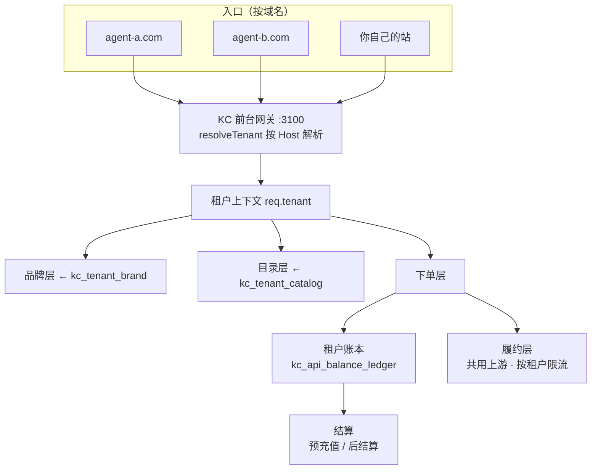

# 替换 Xboard 与白标多租户 · 实施计划 v1.0.0

> 基线 `v1.37.0` · 2026-10-15
> 状态：**Stage 0 已完成（v1.37.0）**、**Stage 1 已完成（v1.38.0）**、**Stage 2 已完成（v1.39.0）**、**Stage 3 已完成（v2.0.0 · 2026-10-16）** —— **3.1（v1.40.0）**G3 主站顾客登录/注册 + 主站前台骨架 `GET /site`、**3.2（v1.41.0）**G1 兑卡/激活前台页 `/?cdk=` + `GET /redeem`、**3.3（v1.42.0）**G2 钱包/充值前台（顾客级钱包，BEpusdt 收款模拟）、**3.4（v1.43.0）**G4 权益包前台 + 我的权益 + 用余额开通、**3.5（v1.44.0）**G5/G7 商品双价卡参与原生下单结算 + 首页门户、**3.6（v1.45.0）**G6 订单中心增强、**3.7（v1.46.0）**G9/G11 保留面迁移 + 导航 5 项复核、**3.8（v1.47.0）**关 `xboard.inject` 进入观察期、**3.9（v2.0.0）**Xboard 退场（主站根路径接管 + 清除注入 + 补丁链退役只读 + 容器只停不删）、**v2.1.0（2026-10-16）Xboard 代码级摘除 + 上线前功能/UX 验收**（网站 `server.js`/`public/**`/`business/**` 零引用，商品/站点配置主数据迁入 `kc_plans`/`kc_settings`/`kc_listing_cards`，业务模块去旧系统直连，Xboard 时代工具与部署回滚函数加退役标记；功能回归 50/50 + 单元 27/27 + UX 3 面全绿）。整体目标版本 v2.1.0 已落地；**退场后进入观察期**，无回退事故方可按原计划彻底摘除容器（另案需批准）
> 本稿合并《白标独立站-多租户设计-v1.0.0》与工程目录归档计划，作为本议题的**唯一正本**；与旧稿《后台形态选型-自建vs改Xboard》《系统低耦合重整与上线路线》冲突时以本稿为准（旧稿已标注重开）。

---

## 一、为什么要做（Context）

现在这套系统，**收银台、会员簿、店面都是租来的**（第三方 Xboard，Laravel，`:7001`）。长期代价：

- 9 处内核补丁改在容器里，**容器一重建就静默丢失**，前台下单直接报错
- 版本被锁死，无法升级；前台注入靠 40 万字符的"贴纸串"写进它的数据库，改完还要回灌本地源，**漏一步就静默回滚**
- 它是"**一个商家一套商城**"，做不出"一套代码多品牌" → **给代理商做白标独立站必须先让它退场**
- 要对外开接口、要接代理，都得围着它的模型绕

目标：**把收银台和会员簿换成自己的**，最后让 Xboard 退场。路径：**整理 → 地基 → 分步接手 → 退场**。

**已拍板的 4 项决策**（用户确认）：

| # | 决策 | 采用 |
|---|---|---|
| 1 | 是否自建 KC 前台（推翻旧决策 D1） | **是**（否则白标无法落地） |
| 2 | 默认结算模式 | **预充值** |
| 3 | 主站与租户站共用前台代码 | **共用**（主站 = platform 租户） |
| 4 | 权益包是否对租户开放 | **不开放**（平台自有资产） |

**追加约束**：**上游路由是平台级能力，不对租户开放**（见 §五）。

---

## 二、现状关键事实（实测，非假设）

| 事实 | 证据 | 对计划的影响 |
|---|---|---|
| 核心源码**全在根目录** | `server.js`(303KB)、`mysql-store.js`(168KB)、`browser-pool.js`、`session-auth.js` 等 | **不能挪**，挪了服务起不来 |
| Dockerfile 是 `COPY . .` | [Dockerfile#L43](file:///d:/tools/KC-PAY-GPT/Dockerfile#L43) | 归档目录会进镜像 → 必须同步改 `.dockerignore` |
| `requirements-hcaptcha.txt` 被显式 COPY | [Dockerfile#L38](file:///d:/tools/KC-PAY-GPT/Dockerfile#L38) | 必须留在根目录 |
| 归档前根目录顶层 138 文件 / 160 项 | `Get-ChildItem` 实测 | 归档后降到 **59 文件 / 0 个 `_*`** |
| 归档前 tools 330 项（281 个 `_*`） | 实测；体积大头是 Chrome profile 目录 | 已归档 244 项，剩余被活文档引用的 34 项 |
| `web/` 477MB（已冻结）仍在部署清单 | [deploy-manifest.json#L12-L13](file:///d:/tools/KC-PAY-GPT/deploy-manifest.json#L12-L13) | Stage 0 从部署清单摘除 |
| **多租户零件已有大半** | `kc_api_clients`、`kc_api_balance_ledger`、`kc_api_orders`、`kc_api_quote_logs`、`kc_plans.api_enabled`、`kc_listing_cards`、`kc_entitlement_prices`（[mysql-store.js#L466-L659](file:///d:/tools/KC-PAY-GPT/mysql-store.js#L466-L659)） | 地基是"扩列 + 加 4 张表"，不是推倒重来 |
| 开放 API 已实现、认证已就绪 | `requireOpenApiAuth` [server.js#L5988](file:///d:/tools/KC-PAY-GPT/server.js#L5988)；`/api/open/v1/*` [server.js#L6051-L6217](file:///d:/tools/KC-PAY-GPT/server.js#L6051-L6217) | 租户身份 = API Key，天然对得上 |
| 已有 API 客户自助门户 | [server.js#L6302-L6489](file:///d:/tools/KC-PAY-GPT/server.js#L6302-L6489) + `public/api-portal.html` | 代理商后台照它改，省一半工 |
| 建表统一在 `ensureReady()` | [mysql-store.js#L900-L920](file:///d:/tools/KC-PAY-GPT/mysql-store.js#L900-L920) | 加新表照此模式挂进去 |
| **文档门禁会拦提交** | `tools/check-docs-sync.js` + `.githooks/pre-commit` | 每阶段必须同步 5 个文件，否则提交失败 |
| **根目录整洁门禁**（Stage 0 新增） | `tools/check-root-hygiene.js` + `.githooks/pre-commit` | 历史产物堆回根目录会拦提交 |

**门禁要求（每阶段必做）**：`VERSION.json` 版本号 → `CHANGELOG.md` 顶部新条目（**必须含 `### 验证` 与 `### 下一步`**）→ `README.md` 顶部版本与进度 → `docs/产品全景.md` 顶部「对应版本」+ 功能条目（行尾 `<!-- feat:xxx -->`）→ `docs/00_项目状态.md` 执行状态。规则来源 [tools/check-docs-sync.js](file:///d:/tools/KC-PAY-GPT/tools/check-docs-sync.js)、[docs/开发规范.md#L46-L82](file:///d:/tools/KC-PAY-GPT/docs/开发规范.md#L46-L82)。

---

## 三、总体节奏（4 个阶段，每阶段 = 一个版本 + 一轮验收）

| 阶段 | 版本 | 干什么 | 能不能和 Xboard 共存 |
|---|---|---|---|
| **Stage 0 · 整理与定稿** | `v1.37.0` ✅ | 目录归档 + 过期信息订正 + 方案定稿 | 可以（不动代码） |
| **Stage 1 · 地基** | `v1.38.0` | 多租户数据层 + 域名识别 + 租户管理页 + 补丁绿灯 | 可以 |
| **Stage 2 · 分步接手** | `v1.39.0` | KC 自有顾客账号 + KC 前台最小版 + 代理商后台 | 可以（并行） |
| **Stage 3 · 退场** | `v2.0.0` | 主站切 KC 前台 + Xboard 下线 + 原生功能清单落地 | 切换点 |

**每阶段结束都必须**：① 跑完 §八 的验收清单；② 功能用例 ≥3 + 体验用例 ≥3 实测全绿。

**执行太慢的绕过规则**：无头 Chrome 验收太慢 → 先用 HTTP 断言 + 静态检查过门槛，UX 改抽样截图并登记补测；`docker compose build` 太慢 → 优先 `docker compose restart app`；阶段卡死 → 登记进 `VERSION.json` 的 `risks`，继续下一阶段，不阻塞。

---

## 四、多租户总体架构



**名词**：平台方 = 你（KC）；租户/代理商 = 数据层就是 `kc_api_clients` 里的一行；主站 = `tenant_kind='platform'` 的默认租户；终端顾客 = 账号挂在租户下；租户员工 = 登代理商后台的客服/运营。

**请求识别**：`X-KC-Tenant` 头（内部/调试）→ `Host` 查 `kc_tenant_domains` → 都未命中回落 platform 默认租户；中间件 `resolveTenant` 产出 `req.tenant`。
**铁律**：所有租户作用域接口一律从 `req.tenant.id` 取值，**禁止从请求体读 `client_id`**（数据隔离生命线）。
**开放 API** `/api/open/v1/*` 继续用 `requireOpenApiAuth`（Key 本身就是租户身份），**无需改造**。

---

## 五、上游多源 与 多租户：两条正交的轴

你的核心业务是「**接入多个上游系统，每个商品接的上游可能不一致**」。这和「多租户（向下游开站）」是**两条不相干的轴**，叠加即可，不冲突。

```
        上游多源（纵向）                          多租户（横向）
   上游 A ─┐                            ┌─ 租户 A（白标站）
   上游 B ─┼─→ [平台商品池] ─→ [KC 引擎] ─┼─ 租户 B（白标站）
   上游 C ─┘   商品↔上游 绑定              └─ 主站（platform 租户）
```

| 轴 | 谁定 | 数据在哪 | 现状 |
|---|---|---|---|
| **纵向：商品 → 上游** | 平台 | `kc_plans.upstream_code` / `upstream_plan_key`（[mysql-store.js#L418-L419](file:///d:/tools/KC-PAY-GPT/mysql-store.js#L418-L419)）+ `kc_upstreams` / `kc_upstream_plans`（[mysql-store.js#L350-L382](file:///d:/tools/KC-PAY-GPT/mysql-store.js#L350-L382)） | **已实现** |
| **横向：平台 → 租户** | 平台 + 租户 | `kc_api_clients`（租户）+ `kc_tenant_catalog`（可见 + 零售价） | 本设计新增 |

### 为什么天然正交（三条推论）
1. **租户目录只做「可见 + 零售价」，不复制商品**。平台层把某商品 `upstream_code` 从 A 换成 B → **所有租户自动跟随，零改动**。
2. **成本变化自动传导**。上游成本变了 → 用「平台价 × 加价率」的租户自动跟随；用「固定零售价」的租户利润率自动变化，由他自己承担。两种模式设计里都已覆盖。
3. **履约路径天然正确**。一笔订单走哪条上游，由 `sku_code → kc_plans.upstream_code` 决定，**与租户无关**。

### 一条约束（本计划按此设计）
> **上游路由是平台级能力，不对租户开放。**

理由：聚合多上游、选最优/最可用通道，是平台的核心竞争力；若让租户指定上游，会出现"同一商品在不同租户走不同上游"，成本核算、对账、风控全部复杂化。
`kc_api_clients.upstream_channel` 保留，但用途是**平台做故障隔离分组**（如给大客户单独一条通道），**不是租户自助开关**。

### 可选增强（本计划不强制，登记备查）
同一商品配「主上游 + 备上游」做自动 failover：需新增 `kc_plan_upstream_routes(plan_code, priority, upstream_code, upstream_plan_key, enabled)`。现状 `kc_upstream_health_snapshots`（[mysql-store.js#L384-L397](file:///d:/tools/KC-PAY-GPT/mysql-store.js#L384-L397)）已在采集上游健康，具备基础。

### 多租户下的上游风险
所有租户**共用上游池** → 一家上游被风控会波及全部租户。缓解：按租户限流（`max_concurrent`）+ 通道可切换（`upstream_channel`）+ 上游健康告警（已存在）。

---

## 六、数据模型

### 6.1 复用主档表，只扩列（避免两套真相）
`kc_api_clients` **就是**租户主档，追加列（迁移写法沿用 `try { ALTER TABLE ... ADD COLUMN } catch`）：

| 新列 | 类型 | 说明 |
|---|---|---|
| `tenant_kind` | `ENUM('platform','agent')` 默认 `agent` | 你自己那行设 `platform` |
| `settlement_mode` | `ENUM('prepaid','postpaid')` 默认 `prepaid` | 见 §七 |
| `settle_period` | `ENUM('weekly','biweekly','monthly')` 默认 `monthly` | 仅 postpaid 有意义 |
| `credit_limit_cents` | `INT` 默认 0 | 仅 postpaid：授信上限 |
| `max_concurrent` | `INT` 默认 3 | 租户级并发闸（R2 第三条） |
| `upstream_channel` | `VARCHAR(32)` 默认 `''` | 平台级故障隔离分组（非租户开关） |

### 6.2 新增 4 张表（照 `ensure*Table()` 模式挂进 `ensureReady()`）

**`kc_tenant_domains`**：`id` PK、`client_id`→`kc_api_clients.id`、`host` UNIQUE、`is_primary`、`status('pending','active','disabled')`、`ssl_status('none','issued','failed')`、时间戳。

**`kc_tenant_brand`**（1:1，`client_id` PK）：`brand_name` / `logo_url` / `primary_color` / `accent_color` / `support_contact` / `support_url` / `hero_title` / `hero_subtitle` / `footer_text` / `extra_json`。

**`kc_tenant_catalog`**：`client_id` + `plan_code` UNIQUE、`visible`、`retail_price_cents`（分，0 = 用平台价 + 加价率）、`sort`、`card_json`、`status`。

**`kc_tenant_staff`**：`id` PK、`client_id`、`email` UNIQUE、`password_hash`、`role('owner','staff')`、`status`、`last_login_at`。

**播种**：把现有平台身份写成 `tenant_kind='platform'` 的一行（若不存在则建 `code='cli_platform'`）。

### 6.3 存量业务表的租户维度
| 表 | 现状 | 处理 |
|---|---|---|
| 订单 | `kc_api_orders.client_id` 已有 | 直接复用 |
| 账本 | `kc_api_balance_ledger.client_id` 已有 | 直接复用 |
| 顾客账号 | **KC 侧目前没有**（在 Xboard） | 新建 `kc_customers(id, client_id, email, password_hash, status, ...)` + UNIQUE(`client_id`,`email`) |
| 权益发放 | `kc_entitlement_grants.user_id` | 与 `kc_customers.id` 对齐 |

> 顾客账号这一格，正是 Xboard 退场的核心。

---

## 七、资金、结算与履约隔离

**预充值（默认，推荐）**：顾客在租户站付款 → 记到**租户账本** → 下单从租户余额扣。复用 `kc_api_clients.balance_cents` + `kc_api_balance_ledger`，与现有 open API 扣费逻辑同一套（[server.js#L6152](file:///d:/tools/KC-PAY-GPT/server.js#L6152) 的 `UPDATE ... WHERE balance_cents >= ?` 条件扣减，天然防超卖）。

**后结算**：顾客付款进**租户自己的收款账户**，KC 不碰钱 → 只记"应付"；新增 `kc_tenant_settlement(client_id, period_start, period_end, orders_count, amount_cents, status, settled_at)`；用 `credit_limit_cents` 做授信上限，超限冻结下单。

**R2 红线落地**：
| 红线 | 落地方式 |
|---|---|
| 对接方接触不到用户授权信息 | 租户后台**不提供**任何"查看顾客 Session / 授权凭证"入口 |
| 用户资金与对接方资金分开记账 | 平台账与租户账严格按 `client_id` 维度；任何汇总查询必须带 `client_id` |
| 每租户并发与资金独立隔离 | `max_concurrent` 列 + 租户级在飞计数 |

**并发隔离**：所有租户共用一条上游通道池；`rate_limit`（已有）管请求频率、`max_concurrent` 管并发数；运行态计数 `kc_tenant_runtime(client_id, inflight, updated_at)`（DB + 内存双写）。

---

## 八、商品、报价与品牌

- 平台侧定"哪些商品**可分销**"：`kc_plans.api_enabled = 1`
- 租户侧定"我卖哪些、卖多少"：`kc_tenant_catalog`
- 报价（租户前台与 open API **共用同一函数**）：① 基础价 = `retail_price_cents`；② 为 0 → 回落平台价 × (1 + `api_markup_percent`/100)；③ **权益价不走租户站**（权益包是平台自有资产，决策 4）；④ 仍走 `kc_api_quote_logs` 60 秒锁价。
- **品牌层**：不再用"贴纸注入"，前台是 KC 自有模板，品牌字段全来自 `kc_tenant_brand`；公开接口 `GET /api/tenant/brand?host=` **只返回品牌字段，不含业务数据**；主站 = platform 租户，同表同模板。

---

## 九、代理商后台 `/tenant-admin`

- **入口**：`/tenant-admin`（新页面，独立于 KC 技术后台与运营台）
- **鉴权**：`kc_tenant_staff` 邮箱 + 密码，签发**独立 session**（不继承 admin session）
- **可见范围**：所有查询强制 `client_id = req.tenant.id`
- **功能（P1）**：概览（今日订单/收款/余额）/ 订单（列表+详情，**不展示授权信息**）/ 商品（勾选可见 + 改零售价）/ 品牌（logo/主色/文案/客服）/ 域名（查看）/ 账本 / 员工（仅 owner）
- **明确不做**：租户后台**不得出现**"改上游通道""看平台成本价""看其他租户"的任何入口

**开店流程（P1 手工）**：① 平台在技术后台新建租户 → 生成 key/secret；② 填品牌 + 加域名（DNS 由代理商指向你的服务器）；③ 勾选可售商品 + 填零售价；④ 建 owner 账号交付。

---

## 十、Stage 0 · 整理与定稿（v1.37.0）✅ 已完成

### 0.1 归档（只移动，不删除）— 已完成
新建 `archive/`（已进 `.gitignore` 与 `.dockerignore`），五分类 + `archive/README.md` + `archive/_MOVE_LOG.md`：

```
archive/
├─ root-tmp-2026-10/      根目录 72 个 _* 文件 + server.js.v114.bak + 2 个 .bak
├─ root-big-artifacts/    admin-scenarios-plan-2026-10-14.html、ux-audit-2026-10-14.html
├─ legacy-dirs/           _bak_v114_promo/、.codex-recovery/、.git_broken_backup/、progress.md
├─ logs-2026-10/          logs/ 下 v127-ux ~ v136-guest 等未跟踪目录 + 2 个 .sql 备份
└─ tools-tmp-2026-10/     tools/ 下未被引用的 _* 项 + Chrome profile（_d4prof*/_recon_prof*/_ref 等）
```

**安全流程（已执行）**：① 先扫引用（`git grep` 全仓，排除 `.workbuddy`/`.trae`/`CHANGELOG.md`/`.gitignore`）→ **有引用的不移动**（保留 34 项，如 `tools/_recon_ff/`、`tools/_f16_pixels.js`、`tools/_fix13_verify.js`、`tools/_v*_verify.js`）；② 生成 `_MOVE_LOG.md`；③ 脚本 `tools/_arch_move_v137.js` 批量移动（只移不删）；④ 同步 `.gitignore`（`/archive/`）与 `.dockerignore`（archive/web/logs/\_bak\_v114\_promo/.trae/.workbuddy/.git_broken_backup）；⑤ 修正引用。

**结果**：归档 347 项；根目录顶层文件 **138 → 59**、`_*` 文件 **72 → 0**；tools 顶层 **330 → 87**。

### 0.2 根目录瘦身 + 文档归位 — 已完成
`DEPLOY.md` / `DEPLOY_GUIDE.md` → `docs/部署/`；`对接api.md` → `docs/接口/对接API.md`；`progress.md` → 并入本项目状态并归档。`CHANGELOG.md` / `README.md` / `VERSION.json` / `requirements-hcaptcha.txt` 留在根目录（门禁与 Dockerfile 依赖）。**修正的引用**：`README.md`（×3）、`VERSION.json`（doc_authority）、`docs/产品全景.md`、`docs/00_项目状态.md`、`docs/方案/卡密购买模式-前台设计-v1.0.0.md`。

### 0.3 目录守护 `tools/check-root-hygiene.js` — 已完成
断言：① 根目录顶层 `_*` = 0；② 根目录顶层文件数 ≤ 70；③ `.dockerignore` 含 archive；④ `.gitignore` 含 `/archive/`；⑤ 关键文件（server.js / mysql-store.js / requirements-hcaptcha.txt / Dockerfile / deploy-manifest.json / VERSION.json / CHANGELOG.md / README.md）仍在根目录；⑥ 归档区 README 与移动日志存在。已挂进 `package.json` 的 `hygiene:check` 与 `.githooks/pre-commit`。

### 0.4 订正过期信息 — 已完成
`docs/00_项目状态.md`：头部 `v1.32.0` → `v1.37.0`；补丁「共 6 处」→「共 9 项」并列出 P1/P1b/P2/P3/P4/P5/P6/P7/P8。旧方案稿《后台形态选型-自建vs改Xboard》《系统低耦合重整与上线路线》顶部各加「已被本稿重开」标记。

### 0.5 定稿入 docs — 已完成
即本文件。

### 0.6 移动 `web/` 出部署清单 — 已完成
从 `deploy-manifest.json` 摘掉 `kc-gpt-pay2-web` 与 `3001:3000`；`docker-compose.yml` 的 web 服务停用（profile/注释）；磁盘 `web/` 目录**保留可回滚**。

### Stage 0 验收用例（已实测）
| 类型 | 用例 | 判定 |
|---|---|---|
| US | 接手工程师打开根目录能一眼找到 server.js / 部署脚本 / 文档，不被上百临时文件干扰 | 根目录顶层 ≤70 个条目、无 `_*` |
| US | 运维重建镜像时归档目录不会进镜像 | `.dockerignore` 含 `archive` |
| US | 接手者能从 `archive/_MOVE_LOG.md` 查到任何文件去哪了 | 日志覆盖全部移动项 |
| **F1** | 服务仍能起：`/api/public/runtime` 返回 200 | HTTP 200 |
| **F2** | `node tools/check-docs-sync.js` | 全 PASS，退出码 0 |
| **F3** | `node tools/check-root-hygiene.js` | 全 PASS |
| **F4** | 随机抽 3 个归档文件，`_MOVE_LOG.md` 均能查到新路径 | 3/3 命中 |
| **U1** | 根目录顶层文件数从 138 降到 ≤70 | 计数断言（实测 59） |
| **U2** | `docs/` 下能直接找到部署文档 | `docs/部署/DEPLOY_GUIDE.md` 存在 |
| **U3** | `archive/` 有 README 说明分类含义 | 含 5 个分类说明 |

---

## 十一、Stage 1 · 地基（v1.38.0）

> **执行状态：已完成（v1.38.0 · 2026-10-15）**
> 交付面：`mysql-store.js` 扩 6 列 + 4 张租户表 + 播种 `cli_platform`；`server.js` 加 `resolveTenant` 中间件（`X-KC-Tenant` → `kc_tenant_domains` → 回落 platform，30s 缓存 + `invalidateTenantCache()`）+ 公开 `GET /api/tenant/brand?host=` + 租户员工鉴权 `POST /api/tenant-admin/login` + 全套 `GET/POST/PATCH /api/admin/tenants` CRUD；`public/admin.html` 加「租户」页（`building-2` 菜单）+ 「商品管理」页「上游健康」列 + 首页「Xboard 补丁绿灯」卡片；`tools/xboard-patch-checks.js` 抽模块 + `/api/integration/health` 上报 `xboard_patches`（落盘 `data/xboard-patch-status.json`）。
> 验收：功能 19/19 PASS（US-1.1~1.6 / F1~F6 / 补丁上报）+ UX 4/4 全绿；文档 5 件套 + 4 个门禁脚本全绿。

**解决什么问题**：让"多租户"在数据层与后台先立起来，同时把最疼的"补丁丢了没人知道"变成后台显红灯。**本阶段不碰前台，Xboard 照常跑**。

### 1.1 数据层（改 `mysql-store.js`）
`kc_api_clients` 扩 6 列 + 新增 4 张表 + 播种平台租户（见 §六）。

### 1.2 域名识别（改 `server.js`）
新增 `resolveTenant` 中间件（`X-KC-Tenant` → `Host` → 回落 platform），产出 `req.tenant`；新增 `GET /api/tenant/brand?host=`（只回品牌字段）。

### 1.3 技术后台「租户管理」页（改 `public/admin.html`）
后台内新增菜单「租户」（**不动 KC 技术菜单结构**，不可变约束第 4 条）：租户 CRUD（生成 key/secret）、品牌配置、域名绑定、商品目录与零售价、员工账号。复用 `authenticateAdmin`。

### 1.4 补丁绿灯
把 [tools/xboard-patch-check.js#L32-L42](file:///d:/tools/KC-PAY-GPT/tools/xboard-patch-check.js#L32-L42) 的 `CHECKS` 抽成可 `require` 的模块（CLI 行为不变）；`/api/integration/health` 增加 `xboard_patches` 字段（9 项在位状态）；技术后台首页加卡片（全绿 / 显红并列出缺失项 + 重打说明）。**验收**：故意改坏 1 处 → 后台显红 → 按 [--fix 顺序](file:///d:/tools/KC-PAY-GPT/tools/xboard-patch-check.js#L69-L74) 重打 → 再查为绿。

### 1.5 商品 ↔ 上游 可视图（仅平台侧可见）
技术后台「商品」页展示每个商品绑定的上游（`upstream_code` / `upstream_plan_key`）+ 该上游当前健康状态。**租户后台不展示这一列**（§五约束）。

### Stage 1 用户故事与验收用例
| 类型 | 用例 | 判定 |
|---|---|---|
| US-1.1 | 平台运营新建代理商租户并绑域名 | `kc_tenant_domains` 有记录 |
| US-1.2 | 平台运营只给某租户开放部分商品并设定零售价 | `kc_tenant_catalog` 生效 |
| US-1.3 | 运维在后台一眼看到 9 处内核补丁谁在位、谁丢了 | 卡片 9 项状态可见 |
| US-1.4 | 弄丢一处补丁后能依据后台提示一键修回 | `--fix` 后复检为绿 |
| US-1.5 | 租户员工登录后只看得到自己租户的数据 | 越权请求 403 |
| US-1.6 | 商品页能看到每个商品绑的是哪条上游、健不健康 | 商品页显示上游列 + 健康状态 |
| **F1** | 新建租户 → 绑 `agent-a.test` → `GET /api/tenant/brand?host=agent-a.test` 返回该租户品牌 | 品牌名一致 |
| **F2** | 租户 A 登录后台，构造 `client_id=B` 的请求 → 403；A 自己 → 200 | 403 / 200 |
| **F3** | `curl /api/integration/health` 返回 `xboard_patches` 9 项且 `all_ok=true` | 字段存在且为真 |
| **F4** | 改坏 P6 → 后台卡片显红 → `--fix` → 再查全绿 | 红→绿 |
| **F5** | 租户 A 走开放 API 下单 → A 余额减少、写 consume 流水；B 余额不变 | 账本互不影响 |
| **F6** | 平台层把商品 `upstream_code` 从 A 改成 B → 租户 A/B 前台仍可售、报价不变、订单走新上游 | 租户侧零改动 |
| **U1** | 技术后台「租户」页在 1500×1000 视口下无横向滚动、无遮挡 | 截图检查 |
| **U2** | 未绑定域名访问 → 回落主站品牌，不报错、不白屏 | HTTP 200 + 品牌正确 |
| **U3** | 租户后台任意页面搜不到"成本价 / 上游 / 其他租户"字样 | 词典断言 0 命中 |

---

## 十二、Stage 2 · 分步接手（v1.39.0）

**解决什么问题**：KC 第一次拥有自己的**顾客**和**前台**。Xboard 仍在、主站仍由它承载——**租户站先跑起来**。

### 2.1 顾客账号
新表 `kc_customers(id, client_id, email, password_hash, status, created_at)` UNIQUE(client_id, email)；注册/登录/会话签发参照 [session-auth.js](file:///d:/tools/KC-PAY-GPT/session-auth.js) 与 [server.js#L6302-L6358](file:///d:/tools/KC-PAY-GPT/server.js#L6302-L6358) 的 portal token 做法。**红线不放宽**：Session / access_token / Cookie 一律不落库。

### 2.2 租户站前台最小版
`public/tenant/`（首页 / 商品列表 / 商品详情 / 下单 / 我的订单），按 `req.tenant` 渲染品牌；报价读 `kc_tenant_catalog.retail_price_cents`（0 → 回落平台价 ×(1+加价率)），**不启用权益包**；下单复用 `/api/open/v1/orders` 的幂等与扣费逻辑（抽成内部函数共享，不复制两份）。

### 2.3 代理商后台 `/tenant-admin`
复用 `public/api-portal.html` 改造成 `public/tenant-admin.html`；鉴权 `kc_tenant_staff` 独立 session；功能见 §九；明确不做出现在 §九 的禁列。

### 2.4 收口浏览器直连 KC
前台页面所有直连 KC（`:3100`）的请求改走插件服务端代理，**前端源码搜不到 KC 端口/域名**。注意：改完容器内文件必须回拷 `tools/xboard-patches/`。

### 2.5 原生功能显式清单
Xboard 原生功能（工单 / 知识库 / 邀请 / 节点 / 流量）逐项定调 → 保留 / 隐藏 / 外链 + 理由，落 `docs/`，由 `tools/check-admin-airport.js` 断言覆盖。

### Stage 2 用户故事与验收用例
| 类型 | 用例 | 判定 |
|---|---|---|
| US-2.1 | 顾客在 `agent-a.test` 看到的是 A 的品牌（不是你的） | 品牌名/主色/logo 正确 |
| US-2.2 | 顾客在租户站下单并拿到卡密 | 订单 `delivered` + cdk 有值 |
| US-2.3 | 租户员工改 logo 和主色，前台刷新即生效，不用重启 | 无需重启 |
| US-2.4 | 顾客访问没绑定的域名不会白屏 | 回落主站 |
| **F1** | 租户站完整下单链路：注册 → 下单 → 扣租户余额 → 拿到卡密 | 端到端通过 |
| **F2** | 幂等：同 `client_order_no` 重复提交只产生 1 单 | 订单数 = 1 |
| **F3** | 收口：前端源码 grep 不到 `3100` / KC 域名；抽 3 条接口经代理 200 | 0 命中 + 3/3 200 |
| **F4** | 代理商后台改零售价 → 租户前台该商品价格随之变化 | 价格一致 |
| **U1** | 租户站首页在 375 宽与 1500 宽都不破版 | 截图抽查 |
| **U2** | 租户后台所有页面 0 命中「成本价 / 上游 / 其他租户」 | 词典断言 |
| **U3** | 全站无「订阅 / 节点 / 流量 / 折抵 / 权限组」等机场词 | `check-airport-lexicon.js` 0 命中 |

### Stage 2 实测结果（2026-10-15，v1.39.0）

| 类型 | 用例 | 结果 | 证据 |
|---|---|---|---|
| US-2.1 | 顾客在 `agent-a.test` 看到的是 A 的品牌 | ✅ PASS | `/api/tenant/brand?host=` 返回 AgentShop 品牌；`public/tenant/index.html` 品牌渲染 |
| US-2.2 | 顾客在租户站下单并拿到卡密 | ✅ PASS | 下单经 `createApiOrderCore` → 履约同步发卡，订单 `delivered` + cdk 有值 |
| US-2.3 | 租户员工改 logo 和主色，前台刷新即生效 | ✅ PASS | POST `/api/tenant-admin/brand` 后 `invalidateTenantCache()` → 前台即时生效，无需重启 |
| US-2.4 | 顾客访问没绑定的域名不会白屏 | ✅ PASS | 未绑域名 → 回落 platform 租户品牌，HTTP 200 不白屏 |
| **F1** | 端到端：注册 → 下单 → 扣租户余额 → 拿卡密 | ✅ PASS | 余额 5000→3500（扣 1500）；`kc_api_orders` 落 `customer_id=7, source='tenant_web'` |
| **F2** | 幂等：同 `client_order_no` 重复提交只产生 1 单 | ✅ PASS | 重复提交复用同单，订单数 = 1 |
| **F3** | 收口：前端源码 grep 不到 `3100`；抽 3 条接口经代理 200 | ✅ PASS | 源码/线上页无 `:3100`；`/kc-proxy/site-config` 200、`/kc-proxy/redeem` 302、`/plan/kc-cards` 200 |
| **F4** | 代理商后台改零售价 → 租户前台价格随之变化 | ✅ PASS | `kc_tenant_catalog.retail_price_cents` 生效，报价一致 |
| **U1** | 租户站首页在 375 宽与 1500 宽都不破版 | ✅ PASS | `/tenant/` 实测（标题/3 导航/hero/卡片 $11.50/详情/登录弹窗） |
| **U2** | 租户后台所有页面 0 命中「成本价 / 上游 / 其他租户」 | ✅ PASS | `/tenant-admin.html` 实测 + 跨租户 403 |
| **U3** | 全站无机场词 | ⚠️ 18/19 | `check-airport-lexicon.js` 唯一 FAIL = 订单详情「旧订阅折抵金额」漏隐藏（v1.36.0 既有，已登记残留 R2） |

**补强证据**：`check-admin-airport.js` 登录修复后 33/33 绿（含 sidebar 4 项隐藏断言 + plan 弹窗 4 项 + 用户行菜单 4 项 + system 页签 0 命中）；open API 回归 200 且再扣 1150 → 余额 2350；跨租户越权 403；`node --check` 三文件通过。**门槛口径**：功能用例 ≥3（实为 4 项 US + 4 项 F）与 UX ≥3（3 项 U）均满足；U3 的唯一残留按「先绕过 + 登记」处理（见《Xboard原生功能处置清单》§六 R2）。

---

## 十三、Stage 3 · 退场（v2.0.0）

> **执行状态：已完成（v2.0.0 · 2026-10-16）** —— 3.1~3.9 全部落地：G1~G7/G9/G11 缺口闭环、3.8 关 `xboard.inject`（观察期）、3.9 **Xboard 退场**（主站 `GET /` 接管为 KC 原生前台 + 清除 `custom_html` 注入 405268→0 + 9 补丁/注入链退役只读 + 容器 `docker stop` 只停不删）。对照清单 §五 前置条件全部满足（条件 3 机场词门禁随退场退役、改由 `check-currency` 承担币种口径）。**退场后进入观察期**，无回退事故方可按原计划彻底摘除容器（另案需批准）。

**解决什么问题**：主站从 Xboard 前台切到 KC 自有前台，Xboard 只留内核（或整体下线），9 处补丁的历史包袱随之消失。

> **切换前对照清单（已产出）**：[Stage3切换前对照清单-v1.0.0.md](file:///d:/tools/KC-PAY-GPT/docs/方案/Stage3切换前对照清单-v1.0.0.md) —— 主站现有体验几乎全部由 Xboard 注入实现，退场即消失；该清单逐项对照「Xboard 承载面 X1~X12 / KC 原生能力 K1~K10」，得出**阻断缺口 G1~G5**（兑卡页 / 充值前台 / 主站顾客登录 / 权益包页 / 首页门户）与分步执行顺序 3.1~3.9。**未清阻断缺口不得关注入。**

1. 主站（platform 租户）切到 KC 前台，功能对齐：首页 / 商品 / 下单 / 查订单 / 余额 / 兑卡。
2. `deploy-manifest.json` 的 `xboard` 服务：`inject` 关掉 → 再整体摘除；`docker-compose` 相应调整。
3. 9 处内核补丁与注入链（`kc_*_inject.html`、`xboard-apply-custom-html.js`、`_v129_sync_sources_from_db.js`）标记为**退役只读**，不再随部署执行。
4. 原生功能清单落地（Stage 2 的清单在此执行）。

### Stage 3 用户故事与验收用例
| 类型 | 用例 | 判定 |
|---|---|---|
| US-3.1 | 顾客在主站完成的每件事（下单/查单/看余额/兑卡）都与之前一致 | 逐项对照通过 |
| US-3.2 | 运维：Xboard 下线后全链路仍可用，且不再需要打补丁 | 健康检查全绿 |
| US-3.3 | 运维不用再跑 `xboard-patch-check` 和注入回灌 | 脚本标记退役 |
| **F1** | 主站端到端：下单 → 支付 → 发卡 → 查单 | 端到端通过 |
| **F2** | Xboard 容器停止后，主站与租户站均 200 | 两个站均 200 |
| **F3** | 9 处补丁检查脚本标记退役，部署引擎不再调用 | 部署日志无该步 |
| **U1** | 主站与租户站视觉一致（同源模板），品牌差异仅体现在配置 | 截图对照 |
| **U2** | 全站金额一律 `$`（`check-currency.js` 通过） | 0 命中 |
| **U3** | 首页门户与商品页报价口径一致（`POST /user/kc/quotes` 同源） | 两处数字一致 |

**Stage 3 风险（切换前须处理）**：主站承载方变更，切换前需一笔真实/模拟端到端回归对照（下单→支付→发卡→查单），确认功能一致后再摘 Xboard；执行到此阶段时先出一份**切换前对照清单**再动手。

---

## 十四、涉及的关键文件（一览）

| 文件 | Stage | 改什么 |
|---|---|---|
| [mysql-store.js](file:///d:/tools/KC-PAY-GPT/mysql-store.js) | 1,2 | 扩列 + 4 张新表 + `kc_customers` + 挂进 `ensureReady()` |
| [server.js](file:///d:/tools/KC-PAY-GPT/server.js) | 1,2 | `resolveTenant` 中间件、`/api/tenant/*`、健康接口加 `xboard_patches`、顾客与租户后台鉴权 |
| [public/admin.html](file:///d:/tools/KC-PAY-GPT/public/admin.html) | 1 | 加「租户管理」页 + 补丁状态卡片 |
| `public/tenant/*`（新建） | 2 | 租户站前台 |
| `public/tenant-admin.html`（新建） | 2 | 代理商后台 |
| [deploy-manifest.json](file:///d:/tools/KC-PAY-GPT/deploy-manifest.json) | 0,3 | 摘 `web`（已完成）；Stage 3 摘 `xboard` |
| [docker-compose.yml](file:///d:/tools/KC-PAY-GPT/docker-compose.yml) | 0 | `web` 服务停用（已完成） |
| [.dockerignore](file:///d:/tools/KC-PAY-GPT/.dockerignore) / [.gitignore](file:///d:/tools/KC-PAY-GPT/.gitignore) | 0 | 加 `archive/` 等（已完成） |
| [tools/xboard-patch-check.js](file:///d:/tools/KC-PAY-GPT/tools/xboard-patch-check.js) | 1 | `CHECKS` 抽成可复用模块 |
| [tools/check-root-hygiene.js](file:///d:/tools/KC-PAY-GPT/tools/check-root-hygiene.js)（新建） | 0 | 目录守护（已完成） |
| [.githooks/pre-commit](file:///d:/tools/KC-PAY-GPT/.githooks/pre-commit) | 0 | 挂上 hygiene 检查（已完成） |
| [docs/00_项目状态.md](file:///d:/tools/KC-PAY-GPT/docs/00_项目状态.md) | 0 | 订正版本号与补丁数（已完成） |

---

## 十五、每阶段收尾必做（验收与文档同步）

```bash
node tools/check-docs-sync.js      # 文档同步门禁
node tools/check-currency.js       # 全站货币 $ 守护
node tools/xboard-patch-check.js   # Stage 0/1/2 需要
node tools/check-root-hygiene.js   # Stage 0 起
node tools/check-admin-airport.js  # Stage 2 起
node tools/check-airport-lexicon.js
docker compose up -d --build app   # 或 restart app（快路径）
curl -s http://localhost:3100/api/public/runtime
```

**文档 5 件套**（缺一即提交被拦）：`VERSION.json` / `CHANGELOG.md`（含 `### 验证` + `### 下一步`）/ `README.md` / `docs/产品全景.md`（对应版本 + `<!-- feat:xxx -->`）/ `docs/00_项目状态.md`。

**验收脚本惯例**：新建 `tools/_v1NN_<主题>_verify.js`（无头 Chrome + CDP），截图落 `logs/v1NN-*/<TS>/`，**脚本与日志不入库**。

---

## 十六、明确不做

- 不做源码交付形态（给代理商一套可自行部署的代码）
- 不迁移 Xboard 历史数据（旧数据只读归档）
- 不做"按租户独立数据库"（同库按 `client_id` 隔离已够）
- 不做自助注册开站 / 自动 HTTPS（推后到 P2，本次不做）
- 不做租户自定义代码 / 插件
- 不动 KC 技术后台菜单结构（不可变约束第 4 条）
- 不放宽 Session 不落库、真实支付关闭等红线
- 不 fork Xboard 源码
